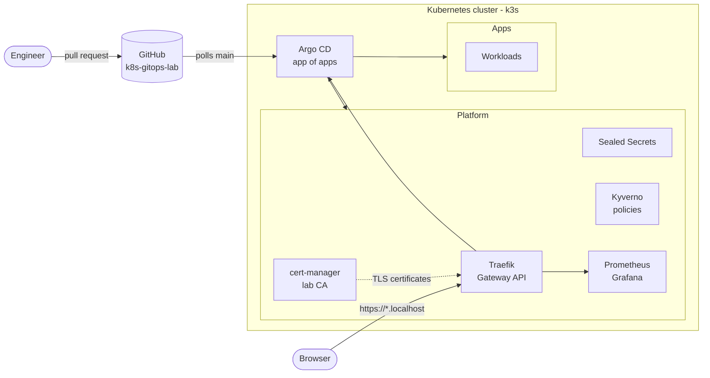

# k8s-gitops-lab

Kubernetes platform managed entirely with **GitOps (Argo CD)**: Gateway API ingress, automatic TLS, encrypted secrets in Git, policy enforcement and observability.

Everything in the cluster is declared in this repository. A change is a pull request; once it is merged, Argo CD applies it. There are no manual `kubectl apply` or `helm upgrade` commands after the one-time bootstrap.

> **Lab scope:** runs locally on Rancher Desktop (k3s). All services are reachable on `*.localhost` only and are not exposed to any network.

---

## Architecture



**Request flow:** browser → Traefik (Gateway + HTTPRoute) → service. HTTP is redirected to HTTPS; certificates are issued automatically by cert-manager.

**Deployment flow:** pull request → merge to `main` → Argo CD detects the change → sync to the cluster. Manual changes in the cluster are reverted (`selfHeal`).

---

## Components

| Component | Chart version | App version | Purpose |
|---|---|---|---|
| [Argo CD](https://argo-cd.readthedocs.io/) | 10.10.3 | v3.5.5 | GitOps engine; manages itself and everything else |
| [Traefik](https://doc.traefik.io/traefik/) | 41.7.1 | v3.7.14 | Ingress layer using the **Kubernetes Gateway API** |
| [cert-manager](https://cert-manager.io/) | v1.21.2 | v1.21.2 | Automatic TLS certificates from an internal lab CA |
| [Sealed Secrets](https://github.com/bitnami/sealed-secrets) | 2.20.0 | v0.40.0 | Encrypted secrets that are safe to store in Git |
| [Kyverno](https://kyverno.io/) | 3.9.2 | v1.19.2 | Policy engine: Pod Security Standards and best practices |
| [kube-prometheus-stack](https://github.com/prometheus-community/helm-charts) | 92.13.1 | v0.94.1 | Prometheus, Grafana, Alertmanager, node-exporter, kube-state-metrics |

All chart versions are pinned. Upgrades are done by changing the version in Git, through a pull request.

| URL | Service |
|---|---|
| https://argocd.localhost | Argo CD |
| https://grafana.localhost | Grafana |

---

## Design decisions

### GitOps with Argo CD (app of apps)
A single `root` Application points to `argocd/`. Every component is an Application in that folder, so adding a component is adding one file. Argo CD **pulls** from GitHub: the cluster needs no inbound access and no credentials are stored in a CI system.

Argo CD manages **its own installation** from Git (self-managed). After the initial Helm install, Argo CD is upgraded and configured like any other component.

### AppProjects: least privilege
| Project | Allowed sources | Allowed destinations | Cluster-wide objects |
|---|---|---|---|
| `platform` | this repo + the official Helm chart repositories | all namespaces | all (CRDs, webhooks, cluster roles) |
| `apps` | this repo only | the app's own namespace | Namespace only |

A mistake in an app manifest can never affect the platform.

### Gateway API instead of Ingress
The community **ingress-nginx** controller was retired in March 2026. This platform uses the **Gateway API** (`Gateway` + `HTTPRoute`), the successor of the Ingress API:

- **Gateway** (`platform/traefik/manifests/gateway.yaml`): the shared entry point, owned by the platform, with one HTTPS listener per hostname.
- **HTTPRoute** (per app): the route to the app, owned by the app, in the app's namespace.

All Gateway API defaults are written out explicitly in the HTTPRoutes, so the live objects match Git exactly and Argo CD reports no drift.

### TLS with an internal CA
cert-manager runs a small PKI, like an enterprise CA:

```
selfsigned-bootstrap (ClusterIssuer)   - used once, to create the root CA
        └── lab-root-ca (Certificate)  - "Cloudcomp Lab Root CA", 10 years
                └── lab-ca (ClusterIssuer) - signs all other certificates
```

The Gateway is annotated with `cert-manager.io/cluster-issuer: lab-ca`; cert-manager issues a certificate for every HTTPS listener automatically.

> The lab root CA is intentionally **not** imported into the operating system trust store, so browsers show a certificate warning. The connection is encrypted with a valid, automatically renewed certificate; only the issuer is not trusted by the browser.

### Secrets: Sealed Secrets
No plain-text secret is ever committed. Secrets are encrypted locally with `kubeseal` and the public certificate in `platform/sealed-secrets/pub-cert.pem`; only the controller in the cluster holds the private key.

```
kubectl create secret ... --dry-run=client -o yaml
    | kubeseal --cert platform/sealed-secrets/pub-cert.pem --format yaml
    > sealedsecret-<name>.yaml        # safe to commit
```

Example: the Grafana admin credentials (`platform/kube-prometheus-stack/manifests/sealedsecret-grafana-admin.yaml`). A SealedSecret is bound to its name and namespace and cannot be decrypted anywhere else.

### Policies: Kyverno
| Policy set | Mode | Notes |
|---|---|---|
| Pod Security Standards – **baseline** (11 policies) | **Enforce** | Blocks privileged containers, host namespaces, hostPath, host ports, unsafe capabilities and sysctls |
| `require-requests-limits` (own policy) | Audit | Every container must declare CPU/memory requests and a memory limit |

Policies are written as **`ValidatingPolicy`** (CEL), the current Kyverno policy type that replaces the deprecated `ClusterPolicy`.

Rollout followed the usual production approach: **Audit first, review the PolicyReports, then Enforce.**

**Policy exceptions** are explicit, narrow and documented. They are only accepted from the `kyverno` namespace, so only platform admins can grant them:

| Exception | Policies | Scope | Reason |
|---|---|---|---|
| `allow-servicelb` | host ports, capabilities, sysctls | `kube-system/svclb-*` | k3s ServiceLB publishes LoadBalancer services on the host |
| `allow-node-exporter` | host namespaces, hostPath, host ports | `monitoring/prometheus-node-exporter` | node-exporter reads metrics from the host |

Every exception records its `reason`, `scope` and `approved-by`, and shows as `skip` in the PolicyReports.

### Observability
kube-prometheus-stack provides Prometheus, Grafana (with ±25 built-in dashboards), Alertmanager, node-exporter and kube-state-metrics.

- k3s embeds etcd, the scheduler, the controller manager and kube-proxy in a single binary; their scrape targets are disabled to avoid permanently failing targets and false alerts.
- Prometheus discovers ServiceMonitors in **all** namespaces, not only those created by its own Helm release.
- Every component has requests and a memory limit, in line with the `require-requests-limits` policy.

### Sync order
Sync waves make sure dependencies exist before they are used:

| Wave | Components |
|---|---|
| -1 | AppProjects |
| 0 | Argo CD |
| 1 | Traefik, cert-manager, Sealed Secrets, Kyverno engine |
| 2 | Kyverno policies and exceptions |
| 3 | kube-prometheus-stack |

### Not in this lab
Rancher Desktop's k3s has a built-in CNI (Flannel) and load balancer (ServiceLB) that cannot be replaced. **Cilium** and **MetalLB** are used in my homelab cluster, not in this lab.

---

## Repository structure

```
k8s-gitops-lab/
├── bootstrap/
│   └── root-app.yaml                  # applied once - the app of apps
├── argocd/
│   ├── projects/                      # AppProjects: platform, apps
│   └── apps/                          # one Application per component ("what")
├── platform/                          # settings per component ("how")
│   ├── <component>/
│   │   ├── values.yaml                # Helm values
│   │   └── manifests/                 # own Kubernetes objects (routes, issuers, policies, ...)
│   └── sealed-secrets/pub-cert.pem    # public key for kubeseal
└── apps/                              # workloads (project "apps")
```

**Conventions**

- Folder name = component name = Application name = namespace.
- Helm settings are always in `values.yaml`; own objects in `manifests/`, one object per file.
- Every Application uses the same pattern: Helm chart (pinned version) + values from this repo + optional `manifests/`.
- File names are lowercase with hyphens; YAML files use `.yaml`.
- Line endings are normalised to LF (`.gitattributes`).

---

## Getting started

### Prerequisites
- [Rancher Desktop](https://rancherdesktop.io/) with Kubernetes enabled, container engine **dockerd**, **Traefik disabled** (Traefik is installed and managed by Argo CD instead)
- `kubectl`, `helm` (included with Rancher Desktop) and [`kubeseal`](https://github.com/bitnami/sealed-secrets/releases) v0.40.0

### Bootstrap (one time)

```bash
# 1. Install Argo CD with the values from this repo
helm repo add argo https://argoproj.github.io/argo-helm
helm install argocd argo/argo-cd --namespace argocd --create-namespace --version 10.10.3 --values platform/argocd/values.yaml

# 2. Hand over to GitOps
kubectl apply -f bootstrap/root-app.yaml
```

From here on, Argo CD installs all other components from Git. After a few minutes:

```bash
kubectl get applications -n argocd
```

> Argo CD takes over its own Helm installation (`argocd/apps/argocd.yaml`). Do not run `helm upgrade` for Argo CD afterwards.

### Initial Argo CD password

```bash
kubectl -n argocd get secret argocd-initial-admin-secret -o jsonpath="{.data.password}" | base64 -d
```

Change it after the first login and delete the `argocd-initial-admin-secret` secret.

---

## Adding a platform component

1. `platform/<component>/values.yaml`, and optionally `platform/<component>/manifests/`
2. `argocd/apps/<component>.yaml`: chart + pinned version + values (copy an existing Application)
3. If the chart comes from a new Helm repository: add it to `sourceRepos` in `argocd/projects/platform.yaml`
4. Web UI: add an HTTPS listener to the Gateway, plus an HTTPRoute and a redirect route in `manifests/`
5. Pull request → merge → Argo CD syncs

---

## Roadmap

- [ ] Loki – logs in Grafana
- [ ] Homarr – first workload in the `apps` project
- [ ] CI – manifest validation (kubeconform, Kyverno CLI) on every pull request
- [ ] Ruleset on `main`
- [ ] Memory limits for all platform charts, then `require-requests-limits` to Enforce
- [ ] Pod Security Standards: from `baseline` to `restricted`

---

## License

[MIT](LICENSE)